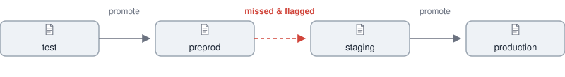

# Envarity

*Config promotion, audited — not just diffed.*

<div align="center">
  
</div>

Most pipelines promote config through a chain of environments like the one
above. When a value doesn't make the jump — or silently changes along the
way — nobody notices until it breaks something in production. **Envarity
diagnoses that gap**: it reads your environment branches directly from git,
compares what should be identical, and tells you *which* differences are
expected and which ones aren't.

Built hands-on: every design decision here was
reviewed, and understood by its author, who used AI as a tool during the
process, not as a replacement for the understaning and evaluating.

## 📝 Why rules, not just a diff?

A raw diff between two environments is mostly noise:

```diff
  APP_NAME: checkout-service                           # identical — nothing to report
- DATABASE_HOST: staging-db.internal
+ DATABASE_HOST: prod-db.internal                      # expected — differs per env
- PAYMENT_API_URL: https://staging.example.com/webhooks/payments
                                                        # missing entirely — not expected
```

Hostnames, URLs, and resource limits are *supposed* to differ per environment.
Envarity separates **expected to differ** from **should have matched** using a
small rule set you define per project, so the output is a short list of things
that actually need to be look at them.

## 🤖 Why not just ask an agent?

It's tempting to point a coding agent at the repo and ask "what's different
between prod and ppt?". That works once, but it's slow and expensive to repeat:
the agent has to read raw YAML across every branch itself, with no guarantee
it checks everything or returns the same shape twice.

Envarity does the deterministic part — reading branches, diffing keys,
classifying them against your rules — in plain, fast, free Python. The LLM
only ever sees the small, already-filtered result, and only for the one job
language models are actually good at: explaining *why* something is risky.
Less context, sent once, in a fixed shape, is cheaper, faster, and more
reliable than asking an agent to rediscover the structure every time.

## 🧩 Functions Overview

What Envarity tool currently offers:

- `repos` — register a git repo and its environment branches/tiers
- `check` — compare placeholder keys between two environments, classified by rule
- `explain` — ask an LLM to summarize a diff and rate how risky it is
- `matrix` — overview of key/flag counts across every app and environment
- `stale-images` — how many days behind each environment's base images are

## ⚙️ Setup & Configuration

```bash
uv sync
cp config/repos.example.yaml config/repos.yaml
cp config/rules.example.yaml config/rules.yaml
```

Everything Envarity does — which repos it knows about, which environments
exist, which keys are allowed to differ — is driven entirely by those two
files: `config/repos.yaml` and `config/rules.yaml`. Both are gitignored —
edit the copies you just created with your own repo path and rules.

`config/repos.yaml` registers one or more repos:

```yaml
repos:
  - name: example-service
    path: /path/to/your/local/clone
    environments:
      - branch: test-1
        tier: test
      - branch: prod
        tier: production
```

The `tier` on each branch labels its place in the promotion chain (`test`,
`staging`, `production`, ...). Envarity uses it to pick a baseline for
comparisons — the branch tagged `production` is treated as the source of
truth that every other environment gets checked against.

`config/rules.yaml` defines which placeholder keys are allowed to differ
between environments (anything *not* matched by a rule is flagged by default):

```yaml
rules:
  - key_pattern: "HOST*"
    expect: differs
```

The `explain` command additionally needs LLM connection details in a local
`.env` (also gitignored):

```bash
ENVARITY_LLM_BASE_URL=https://your-gateway-url
ENVARITY_LLM_API_KEY=your-key
ENVARITY_LLM_MODEL=your-model-name
```

`explain` also pulls few-shot calibration examples from `config/few_shots/`
(gitignored, same pattern as above) — a handful of real diffs you've judged
by hand, each as its own JSON file:

```json
{
  "repo": "example-service",
  "file": "app.yaml",
  "from": "staging",
  "to": "production",
  "expected_risk": "low",
  "summary": "...",
  "reasoning": "..."
}
```

`config/few_shots/*.example.json` ships in git as a template; without any
real cases present, `explain` just falls back to running uncalibrated (and
tells you so).

## 💻 Usage

### `repos list` / `repos validate`

List the repos Envarity knows about, or check that every branch they
reference actually exists in git.

```bash
uv run envarity repos list
uv run envarity repos validate
```

### `check`

Compare placeholder keys between two environments of one repo, classified
by your rules into "expected" and "flagged" differences.

```bash
uv run envarity check <repo-name> --file <app>.yaml --from <branch> --to <branch>
```

### `explain`

Send a diff to an LLM (via your OpenAI-compatible gateway) and get back a
JSON summary, a risk rating, and the reasoning behind it — calibrated with
a few real, hand-judged examples from `config/few_shots/` so the model
doesn't just guess from the field names alone.

```bash
uv run envarity explain <repo-name> --file <app>.yaml --from <branch> --to <branch>
uv run envarity explain <repo-name> --file <app>.yaml --from <branch> --to <branch> --no-fewshot
```

### `matrix`

An overview across every app and every environment in a repo at once — how
many keys each one has, and how many of those are flagged.

```bash
uv run envarity matrix <repo-name>
```

### `stale-images`

How many days behind each environment's base images are, compared to the
newest version seen anywhere in the repo.

```bash
uv run envarity stale-images <repo-name>
```
